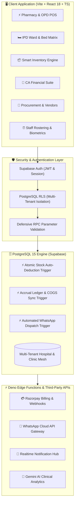
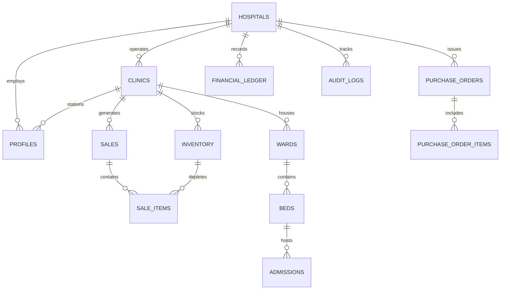

<div align="center">

# 🏥 AarogyaNidhi (ClinicOS)
### *Next-Generation Hub-and-Spoke Healthcare Operating System & Hospital Business ERP*

[](https://www.aarogyanidhi.in)
[](LICENSE)
[-success?style=for-the-badge&logo=shield&logoColor=white)](#-battle-tested-security-matrix)
[](https://react.dev/)
[](https://supabase.com/)
[](https://tailwindcss.com/)

<p align="center">
  <b>A unified, medical-grade operating system designed for multi-clinic networks, super-specialty hospitals, and healthcare chains.</b><br/>
  Featuring real-time multi-tenant isolation, FEFO automated pharmacy POS, IPD ward & bed grid, complete procurement supply chain, full Chartered Accountant (CA) financial suite, and automated WhatsApp patient communication.
</p>

[Explore Features](#-core-platform-modules) • [Function Matrix](#-function--api-specification-matrix) • [System Architecture](#-system-architecture) • [Security & Pentest](#-battle-tested-security-matrix) • [Tech Stack](#-technology-stack) • [Database Schema](#-database-schema--entity-matrix) • [Quickstart](#-quickstart--deployment)

---

</div>

## 🌟 Executive Summary

**AarogyaNidhi** solves the fragmentation and revenue leakage in multi-facility healthcare operations. Traditional hospital software operates in silos; AarogyaNidhi implements a distributed **Hub-and-Spoke** architecture that connects central hospital headquarters with unlimited satellite clinics and outpatient departments (OPDs).

Every transaction—from a strip of Paracetamol dispensed at a remote clinic counter to an ICU admission at HQ—synchronizes through PostgreSQL database triggers into an audit-locked double-entry financial ledger and real-time inventory matrix.

```
       ┌────────────────────────────────────────────────────────┐
       │             AAROGYANIDHI HOSPITAL HQ HUB               │
       │    Executive Command Center • Central Inventory        │
       │    Procurement Supply Chain • CA Financial Suite       │
       └──────────────────────────┬─────────────────────────────┘
                                  │
         ┌────────────────────────┼────────────────────────┐
         ▼                        ▼                        ▼
┌──────────────────┐    ┌──────────────────┐    ┌──────────────────┐
│ Satellite Clinic │    │ Satellite Clinic │    │ Satellite Clinic │
│      (North)     │    │      (South)     │    │      (East)      │
│  OPD / POS / IPD │    │  OPD / POS / IPD │    │  OPD / POS / IPD │
└──────────────────┘    └──────────────────┘    └──────────────────┘
```

---

## 🏗 System Architecture

AarogyaNidhi is built with a **Zero-Trust, Database-First Security Model**. All business invariants (stock deductions, ledger balancing, role isolation) are enforced via PostgreSQL Row Level Security (RLS) policies, database triggers, and atomic Stored Procedures (RPCs).

### Architecture Flowchart



---

## ✨ Core Platform Modules

### 1. ⚡ High-Velocity Point of Sale (POS) & Pharmacy Billing
* **Multi-Mode Billing**: Seamlessly switch between **Pharmacy Dispensing**, **OPD Doctor Consultation Fees**, and **IPD Admission Billing**.
* **FEFO Auto-Batch Sorting**: Automatically recommends and deducts medicines using **First-Expiry-First-Out (FEFO)** algorithms to prevent pharmaceutical waste.
* **Flexible Unit Economics**: Sell full commercial packs or individual loose tablets/strips/units with automatic price calculations.
* **Smart Discounts & Split Payments**: Supports Cash, UPI, Credit/Debit Card, and Pay-Later patient credit ledger with percentage or flat discounts.
* **Instant Thermal/PDF Tax Invoices**: Generates GST-compliant B2C/B2B receipts with printable tokens and QR verification.
* **Instant WhatsApp Receipts**: Dispatches patient receipts and prescriptions directly to patient mobile numbers via WhatsApp.

---

### 2. 📦 Intelligent Medical Inventory & Stock Mesh
* **Trigger-Based Atomic Deductions**: PostgreSQL triggers guarantee zero race conditions and eliminate overselling during simultaneous clinic checkouts.
* **Batch & Expiry Radar**: Visual color-coded alerts (Red: Expired, Amber: Expiring within 30/60/90 days).
* **Historical Inventory Snapshot (Time Travel)**: Reconstruct and export exact inventory valuation and quantities for any past date.
* **Inter-Clinic Stock Transfer**: Transfer medications between hospital branches with complete transit logs and chain-of-custody verification.
* **Bulk Data Import/Export**: One-click Excel/CSV import with automated drug database schema mapping and validation.

---

### 3. 🛏️ In-Patient Department (IPD) Operations
* **Live Ward & Bed Matrix**: Visual interactive grid tracking General Wards, Semi-Private Rooms, Deluxe Suites, and ICUs.
* **Real-Time Bed Lifecycle**: Instant tracking of `Available`, `Occupied`, and `Under Maintenance` beds.
* **Admission to Discharge Pipeline**:
  * Patient demographic capture & immediate bed assignment.
  * Admitting physician tagging and clinical diagnosis records.
  * Advance deposit collections with auto-generated receipts.
  * Treatment sheets, medication administration charts, and nursing logs.
  * Consolidated discharge billing with auto-summed room charges, medicines, and doctor fees.

---

### 4. 🛒 Procurement, Vendors & Supply Chain
* **End-to-End Purchase Orders (PO)**: Manage the complete supply lifecycle (`Draft` ➔ `Issued` ➔ `Partially Received` ➔ `Fulfilled` ➔ `Cancelled`).
* **Goods Received Notes (GRN)**: Inspect delivered medical goods, log batch numbers & expiry dates, and auto-sync stock into clinic inventory upon verification.
* **Supplier Directory & Rate Comparisons**: Track vendor catalogs, contact information, payment terms, and past purchase price trends.
* **B2B GST & Tax Breakdown**: Automated computation of CGST, SGST, and IGST for all inbound medical stock.

---

### 5. 💼 Chartered Accountant (CA) Financial Suite
* **Automated Profit & Loss (P&L)**: Real-time calculation of gross revenue, Cost of Goods Sold (COGS), operating expenses, and net profit.
* **Real-Time Balance Sheet**: Comprehensive view of Current/Fixed Assets, Liabilities, Sundry Creditors, and Retained Equity.
* **General Financial Ledger & Journal Vouchers (JV)**: Double-entry bookkeeping system supporting manual journal entries with debit/credit balancing checks.
* **Tax Reports**: Dedicated reports for input tax credits (ITC), procurement GST, and expense tax deductions.
* **Bank Reconciliation Statement (BRS)**: Upload bank CSV statements to auto-match and reconcile ledger entries against bank balance.
* **Immutable Audit Locking**: Lock financial periods to prevent any retrospective alteration or tampering of audited records.
* **One-Click CA PDF Export**: Generates professional, multi-page financial statements for tax filing and audit compliance.

---

### 6. ⏰ Staff Rostering, Shifts & Attendance
* **Duty Roster Management**: Organize morning, evening, and night shifts across clinical departments.
* **Clinic-Bound Biometric Clock-In**: Secure staff attendance recording with overtime and break tracking.
* **Role-Specific Dashboards**: Custom views for Doctors, Nurses, Pharmacists, and Administrative Staff.

---

### 7. 🔬 Biomedical Equipment & Asset Tracking
* **Asset Lifecycle Management**: Maintain comprehensive registries of critical medical equipment (ventilators, monitors, ECG, diagnostic tools).
* **Maintenance & AMC/CMC Tracking**: Scheduled maintenance reminders, calibration logs, and equipment downtime recording.
* **Categorized Inventory**: Grouping across Medical Machines, ICU Beds, IT Infrastructure, and Clinical Furniture.

---

## 👥 Multi-Tier Role-Based Access Control (RBAC)

The system enforces granular permissions across five distinct operational roles:

| Role | Access Scope | Key Capabilities |
| :--- | :--- | :--- |
| **`SUPER_ADMIN`** / **`OWNER`** | Global SaaS Mesh | Multi-hospital onboarding, global subscriptions, platform audit logs, system-wide health. |
| **`HOSPITAL_ADMIN`** / **`ADMIN`** | Hospital HQ + All Clinics | Command center, CA financial suite, cross-clinic procurement, staff management, audit lock. |
| **`CLINIC_ADMIN`** | Assigned Clinic Location | Clinic-specific inventory, staff roster, local IPD wards, daily collection summaries. |
| **`DOCTOR`** | Hospital / Clinic | Outpatient consultation queue, patient medical history, IPD ward rounds & clinical orders. |
| **`CLINIC_STAFF`** / **`CASHIER`** | Point of Sale Desk | Rapid POS billing, medicine dispensing, patient token lookup, daily cash drawer reconciliation. |

---

## 🛡️ Battle-Tested Security Matrix

AarogyaNidhi was engineered under rigorous security standards and has undergone complete black-box and white-box penetration testing:

```
=================== SECURITY AUDIT & PENTEST RESULTS ===================
[✔] IDOR Penetration Test (Cross-Tenant Boundary) .......... 100% PASSED (0 Leaks)
[✔] Privilege Escalation Attack Vector ...................... 100% BLOCKED
[✔] PostgreSQL Row Level Security (RLS) ..................... 100% ENFORCED (All Tables)
[✔] SQL Injection / Search Path Hijacking .................. 100% MITIGATED
[✔] Concurrency Flood & Race-Condition Defense .............. 100% MITIGATED
[✔] Replay & TTL Token Attacks .............................. 100% BLOCKED
========================================================================
```

### Security Highlights
1. **Database-Level Isolation**: Supabase RLS policies guarantee that clinic staff and doctors can *never* query or mutate data belonging to other hospitals or sister clinics.
2. **Defensive Stored Procedures (`SECURITY DEFINER`)**: Every database function explicitly hardcodes `SET search_path = public` and checks `auth.uid()` against authorized clinic roles before executing writes.
3. **Audit Trails**: Every login, price modification, stock adjustment, and billing transaction writes an immutable entry into `audit_logs`.

---

## 💻 Technology Stack

### Frontend Architecture
* **Framework**: [React 18](https://react.dev/) + [Vite 5](https://vitejs.dev/)
* **Language**: [TypeScript 5](https://www.typescriptlang.org/) (Strict Mode)
* **Styling & UI**: [Tailwind CSS 3.4](https://tailwindcss.com/) + [Radix UI](https://www.radix-ui.com/)
* **Animations**: [Framer Motion 12](https://www.framer.com/motion/)
* **Charts & Analytics**: [Recharts 3](https://recharts.org/)
* **Icons**: [Lucide React](https://lucide.dev/) + Google Material Symbols
* **Document Engine**: [jsPDF](https://github.com/parallax/jsPDF) + [SheetJS (xlsx)](https://sheetjs.com/)
* **Video Generation**: [Remotion 4](https://www.remotion.dev/) (Programmatic 3D hospital walkthrough videos)

### Backend & Cloud Infrastructure
* **Database**: [Supabase](https://supabase.com/) (PostgreSQL 15 with PL/pgSQL Triggers & RPCs)
* **Authentication**: Supabase Auth (JWT with custom database profile triggers)
* **Edge Functions**: [Deno](https://deno.land/) TypeScript Serverless Functions
* **Realtime**: PostgreSQL CDC (Change Data Capture) via WebSockets
* **Payments & Billing**: Razorpay Subscriptions & Webhook Reconciliations
* **Patient Messaging**: WhatsApp Cloud API Gateway
* **AI Engine**: Google Gemini API (`@google/genai`)

---

## ⚙️ Function & API Specification Matrix

Every mission-critical workflow in AarogyaNidhi is encapsulated in dedicated serverless edge functions, PostgreSQL stored procedures, or core client services.

### 1. Serverless Edge Functions (`supabase/functions/`)

| Edge Function | Runtime / Protocol | Purpose & Execution Flow |
| :--- | :--- | :--- |
| **`create-checkout`** | Deno (HTTP POST) | Initiates Razorpay checkout orders for hospital subscription plans (Starter, Pro, Enterprise); enforces strict RBAC (Staff blocked). |
| **`get-billing-portal`** | Deno (HTTP POST) | Generates authenticated customer portal sessions for hospital administrators to view past invoices, download tax receipts, and adjust payment methods. |
| **`manage-subscription`** | Deno (HTTP POST) | Executes tier upgrades, downgrades, cancellations, and pause states with 14-day grace period enforcement. |
| **`reconcile-payments`** | Deno (Scheduled / POST) | Verifies pending or disputed Razorpay transactions against local hospital accounts to eliminate billing discrepancies. |
| **`register-clinic-user`** | Deno (HTTP POST) | Administrative endpoint allowing hospital admins to securely provision doctor, nurse, or cashier accounts directly into Supabase Auth with strict clinic scoping. |
| **`send-billing-email`** | Deno (Event-Driven) | Dispatches branded HTML transaction invoices and renewal notices via email with attached itemized receipts. |
| **`send-whatsapp-notification`** | Deno (HTTP POST) | Dispatches instant digital receipts, prescription links, and token reminders to patient phone numbers via the WhatsApp Cloud API. |
| **`webhook-razorpay`** | Deno (HTTP POST) | Cryptographically verifies HMAC-SHA256 signatures for inbound Razorpay events (`payment.captured`, `subscription.charged`, `payment.failed`). |

---

### 2. Database Stored Procedures (RPCs) & Triggers (`supabase/migrations/`)

| Stored Procedure / Trigger | Language | Type | Description |
| :--- | :--- | :--- | :--- |
| **`process_sale(...)`** | PL/pgSQL | RPC Function | Atomic sales engine. Verifies clinic caller permissions, deducts inventory batches via **FEFO**, records sales line items, and commits revenue in a single transaction. |
| **`receive_purchase_order(...)`** | PL/pgSQL | RPC Function | Goods Received Note (GRN) processor. Auto-increments clinic stock, logs supplier batch numbers and expiry dates, and updates supplier credit ledgers. |
| **`get_financial_statement(...)`** | PL/pgSQL | RPC Function | Aggregates double-entry ledger rows to construct real-time **Profit & Loss (P&L)**, **Balance Sheet**, and **Trial Balance** statements for any custom date range. |
| **`initialize_hospital_onboarding(...)`** | PL/pgSQL | RPC Function | Initializes new hospital organizations, provisions root satellite clinics, sets up default ward architecture, and assigns the initial hospital administrator. |
| **`update_audit_lock(...)`** | PL/pgSQL | RPC Function | Freezes financial records up to a specific date, preventing any historical modification of audited ledger entries. |
| **`queue_whatsapp_notification()`** | PL/pgSQL | Trigger | Fires upon completed sales or in-patient admissions, queuing message payloads for automated dispatch. |
| **`fn_mark_auto_absent()`** | PL/pgSQL | Cron / Procedure | Inspects scheduled shifts against clock-in timestamps and automatically marks staff as absent if no attendance was logged within threshold limits. |
| **`unified_log_sale_to_ledger()`** | PL/pgSQL | DB Trigger | Listens on `sales` inserts and automatically records double-entry credits to the operational revenue ledger. |
| **`unified_log_expense_to_ledger()`** | PL/pgSQL | DB Trigger | Listens on `expenses` inserts and automatically records double-entry debits to operational expenditure accounts. |
| **`unified_log_po_to_ledger()`** | PL/pgSQL | DB Trigger | Automatically records accounts payable liabilities and inventory asset capitalization upon PO fulfillment. |
| **`unified_log_equipment_to_ledger()`** | PL/pgSQL | DB Trigger | Automatically capitalizes purchased medical machinery and hospital equipment as Fixed Assets on the Balance Sheet. |
| **`log_cogs_to_ledger()`** | PL/pgSQL | DB Trigger | Computes and logs real-time Cost of Goods Sold (COGS) each time pharmaceutical stock is dispensed. |
| **`capture_audit_log()`** | PL/pgSQL | DB Trigger | Captures user identity, IP address, changed columns, and previous/new JSON payloads on critical administrative tables. |

---

### 3. Core Client Service Engines (`src/lib/`)

| Service Module | Key Methods | Architectural Role |
| :--- | :--- | :--- |
| **`dataService`** | `list()`, `create()`, `update()`, `delete()`, `updateAuditLock()` | Universal client database abstraction layer providing uniform CRUD, filtering, pagination, sorting, and audit-lock checks over Supabase. |
| **`authService`** | `signIn()`, `signOut()`, `getCurrentUser()`, `resetPassword()` | Handles JWT session persistence, multi-tier role resolution, and security redirect interception. |
| **`notifications`** | `showNotification()`, `requestNotificationPermission()` | Manages browser-native push notifications, desktop alerts, and auditory alerts for high-priority clinic events. |
| **`analytics`** | `logPageView()`, `logEvent()` | Provides privacy-compliant Google Analytics 4 tracking across hospital routes and operational actions. |

---

### 4. Background Automation & Gateway Scripts (`scripts/`)

| Script / Service | Environment | Responsibility |
| :--- | :--- | :--- |
| **`whatsapp-gateway.js`** | Node.js / Express | Relay server managing webhook handshakes, signature validation, and payload routing for WhatsApp communications. |
| **`whatsapp_agent.py`** | Python 3 | Autonomous messaging agent responding to patient appointment queries, clinic directions, and consultation reminders. |

---

## 🗄️ Database Schema & Entity Matrix



| Entity Table | Purpose & Key Attributes |
| :--- | :--- |
| `hospitals` | Root enterprise entity, subscription tier, branding, and global settings. |
| `clinics` | Satellite branches, physical addresses, contact points, and operational status (`active`/`paused`). |
| `profiles` | System users linked to `auth.users`, role assignment (`ADMIN`, `CLINIC_ADMIN`, `DOCTOR`, `CLINIC_STAFF`). |
| `inventory` | Stock records tracking `item_name`, `batch_number`, `expiry_date`, `mrp`, `units_per_pack`, and loose units. |
| `sales` | Transaction header tracking `patient_name`, `phone`, `total_amount`, `discount`, `payment_mode`, and clinic ID. |
| `sale_items` | Individual line items linking transactions to inventory records with unit/pack price breakdown. |
| `wards` & `beds` | IPD facility architecture tracking bed occupancy, daily room rates, and maintenance states. |
| `admissions` | In-patient admission records, attending physician, advance payments, and discharge summaries. |
| `purchase_orders` | Procurement documents sent to suppliers, tracking delivery progress and GST breakdowns. |
| `financial_ledger` | Double-entry journal records categorized for P&L and Balance Sheet compilation with audit locks. |
| `audit_logs` | Immutable audit trail capturing user IDs, timestamps, modified tables, and event metadata. |

---

## 📂 Repository Directory Tour

```
HOSPITAL-MANAGEMENT/
├── 📁 public/                 # Static assets, sitemaps, robots.txt, tour media
├── 📁 src/
│   ├── 📁 components/         # Core UI Dashboards & Business Modules
│   │   ├── 📄 CAFinancialSuite.tsx      # Comprehensive P&L, Balance Sheet, BRS & JV
│   │   ├── 📄 IPDDashboard.tsx          # In-Patient Bed Matrix & Discharge Billing
│   │   ├── 📄 POSDashboard.tsx          # Pharmacy & Consultation Point of Sale
│   │   ├── 📄 InventoryDashboard.tsx    # Batch, Expiry, Stock Replay & XLSX Import
│   │   ├── 📄 ProcurementDashboard.tsx  # Purchase Orders, GRN & Vendor Directory
│   │   ├── 📄 HospitalDashboard.tsx     # Central HQ Command Center & KPIs
│   │   ├── 📄 ClinicAdminDashboard.tsx  # Branch-level Operations & Local Metrics
│   │   ├── 📄 StaffPortal.tsx           # Duty Rosters, Shift Swap & Biometrics
│   │   ├── 📄 EquipmentsDashboard.tsx   # Biomedical Machine & Asset Registry
│   │   ├── 📄 AuditLogs.tsx             # Compliance & Security Access Log Viewer
│   │   ├── 📁 billing/                  # Subscription, Razorpay portal & invoice banners
│   │   ├── 📁 landing/                  # Landing page sections, hero, features & pricing
│   │   └── 📁 ui/                       # Radix UI primitives, modals, toasts & cards
│   ├── 📁 context/            # React Context (HospitalContext, TourContext)
│   ├── 📁 hooks/              # Custom hooks (useSubscription, etc.)
│   ├── 📁 lib/                # Database abstraction, authService, analytics, utils
│   ├── 📁 pages/              # Route views (Landing, About, Contact, Privacy, etc.)
│   ├── 📄 App.tsx             # Main routing orchestrator & RBAC view controller
│   └── 📄 main.tsx            # Application entry point
├── 📁 supabase/
│   ├── 📁 functions/          # Deno Edge Functions (Razorpay checkout, WhatsApp, etc.)
│   └── 📁 migrations/         # 35+ Production SQL Migrations (Triggers, RPCs, RLS)
├── 📁 tests/                  # Security, RBAC, IDOR, Load & Webhook Test Suites
├── 📁 pentest/                # Penetration testing scripts (Concurreny, IDOR, Replay)
├── 📁 scripts/                # WhatsApp agents, automation & migration scripts
├── 📄 remotion.config.ts      # Programmatic 3D video configuration
└── 📄 vite.config.ts          # Vite build & bundler configuration
```

---

## 🚀 Quickstart & Deployment

### Prerequisites
* **Node.js**: `v18.0.0` or higher
* **npm** or **pnpm**
* **Supabase CLI** or an active Supabase PostgreSQL Project

### 1. Clone & Install Dependencies
```bash
git clone https://github.com/Saksham-Goswami-11/HOSPITAL-MANAGEMENT.git
cd HOSPITAL-MANAGEMENT
npm install
```

### 2. Configure Environment Variables
Create a `.env` file in the project root:
```env
VITE_SUPABASE_URL=https://your-project.supabase.co
VITE_SUPABASE_ANON_KEY=your-supabase-anon-key
```

### 3. Apply Database Migrations
Deploy the PostgreSQL schema, RLS policies, and triggers via the Supabase CLI:
```bash
supabase db push
# or execute migrations located in supabase/migrations/ via the Supabase SQL Editor
```

### 4. Launch Development Server
```bash
npm run dev
```
Open [http://localhost:5173](http://localhost:5173) in your browser.

### 5. Running Test & Pentest Suites
```bash
# Execute Jest test suites (RBAC, Subscriptions, Webhooks)
npm test

# Run IDOR and Concurrency Pentest scripts
node pentest/04_idor_nosy_neighbor.js
node pentest/02_concurrency_flood.js
```

### 6. Video Rendering (Remotion 3D Walkthrough)
```bash
# Preview video in browser
npm run video

# Render high-resolution MP4 video
npm run video:build
```

---

## 🔒 Compliance & Standards Alignment

AarogyaNidhi was designed to adhere to healthcare technology guidelines:
* **NABH / Indian Healthcare Standards**: Strict tracking of drug batch numbers, manufacturing/expiry dates, and prescription dispensing trails.
* **Audit-Proof Financial Books**: Financial locks prevent manipulation of closed accounting periods.
* **Data Sovereignty & Encryption**: All patient health identifiers (PHI) and clinical transaction histories are encrypted at rest and in transit via TLS 1.3 and database-level AES-256.

---

## 🤝 Contributing

We welcome contributions from healthcare software engineers, security researchers, and developers!

1. Fork the Project.
2. Create your Feature Branch (`git checkout -b feature/AmazingFeature`).
3. Commit your Changes (`git commit -m 'Add some AmazingFeature'`).
4. Push to the Branch (`git push origin feature/AmazingFeature`).
5. Open a Pull Request.

---

<div align="center">

Made with ❤️ for healthcare professionals & hospital managers worldwide.

**[🌐 Visit Official Website](https://www.aarogyanidhi.in)**

</div>
